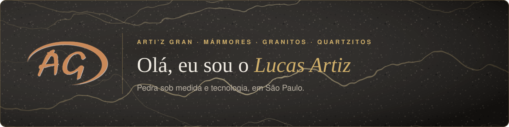
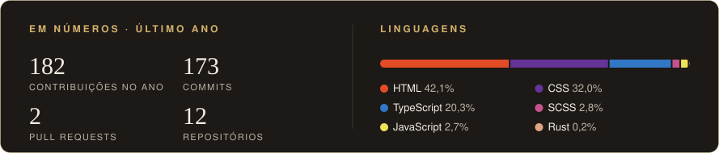

  

 

Sou da **[Arti'z Gran](https://artizgran.com.br)**, marmoraria em São Paulo com mais de 15 anos de projetos sob medida: cozinhas, lavatórios, escadas e lareiras em mármores, granitos e quartzitos, nacionais e importados.

Aqui no GitHub fica o meu lado de código: o sistema que usamos no dia a dia da empresa e os projetos que faço por fora.

  
  
  
  
  

 

<h3 align="center">Meus commits viram granito</h3>

  
   
  A politriz passa pela pedra bruta e cada dia com commit fica polido: Branco Itaúnas, Cinza Andorinha, Verde Ubatuba e Preto São Gabriel.

 

  

 

  MÁRMORES · GRANITOS · QUARTZITOS · QUARTZO · DEKTON · ULTRACOMPACTOS

